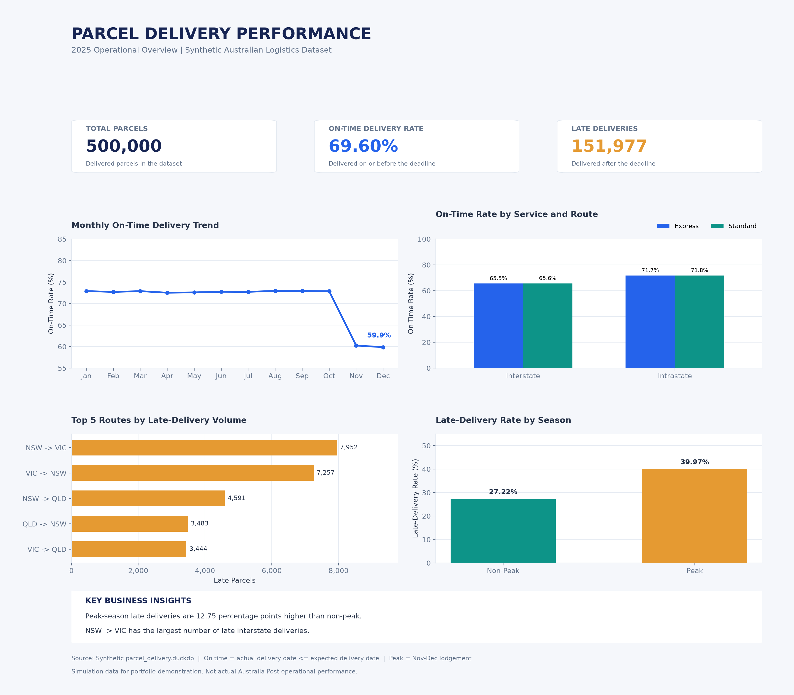

# Parcel Delivery Analytics

### End-to-End Logistics Performance Analysis | DuckDB, SQL, Python, pandas & Matplotlib

An end-to-end data analytics project investigating parcel delivery performance across Australia using **500,000 synthetic parcel records and 2 million tracking events**.

The project demonstrates how SQL and Python can be used to validate operational data, monitor delivery KPIs, identify high-impact delivery routes, investigate seasonal patterns, and support operational decision-making through scenario analysis and executive reporting.

> **Disclaimer:** This project uses independently generated synthetic data. It is not affiliated with Australia Post and does not represent its actual operational performance.

## Executive Dashboard



The dashboard summarises delivery performance through headline KPIs, monthly on-time trends, service-level comparisons, interstate route rankings, and peak-season analysis.

## Business Objectives

The project investigates five main questions:

1. **Data reliability:** Can parcel and tracking records be trusted for performance reporting?
2. **Operational performance:** Which interstate routes experience the largest volumes of late deliveries?
3. **Improvement opportunities:** How would a hypothetical reduction in late deliveries affect overall performance?
4. **Service performance:** How do Express and Standard compare in delivery speed, reliability and delay severity?
5. **Delay patterns:** How are delivery outcomes associated with peak season and parcel weight?

## Tools and Technologies

| Technology | Purpose |
|---|---|
| Python | Synthetic data generation and analytical workflow |
| DuckDB | Local analytical database and SQL execution |
| SQL | Data validation, joins, aggregation, window functions and KPI calculation |
| pandas | Data transformation and preparation for visualisation |
| Matplotlib | Charts and executive dashboard |
| PyCharm | Development environment |
| Git/GitHub | Version control and project documentation |

## Dataset

The dataset was generated using Python with NumPy and pandas, using a fixed random seed for reproducibility.

| Table | Records | Description |
|---|---:|---|
| `parcels` | 500,000 | Parcel origins, destinations, service types, weights and delivery dates |
| `tracking_events` | 2,000,000 | Lodgement, origin processing, destination processing and delivery events |
| `facilities` | 8 | Synthetic processing facilities representing Australian states and territories |

### Dataset characteristics

- Eight Australian states and territories
- Standard and Express services
- Intrastate and interstate delivery routes
- Parcel lodgement dates during 2025
- Higher synthetic parcel volumes during November and December
- Service-specific expected delivery windows
- Simulated early, on-time and delayed deliveries

The generator uses simplified operational assumptions rather than modelling the full complexity of a real parcel network.

## Key Findings

### 1. Overall Delivery Performance

Across 500,000 parcels:

| Metric | Result |
|---|---:|
| Total parcels | 500,000 |
| On-time deliveries | 348,023 |
| Late deliveries | 151,977 |
| Overall on-time delivery rate | 69.60% |

A delivery is considered on time when its actual delivery date is on or before its expected delivery date.

### 2. Data Quality and KPI Consistency

All parcels have exactly four tracking events in the generated dataset.

However, the analysis identified:

- 10,605 parcels with delivery-date disagreements between the parcel and tracking tables.
- 531 parcels whose on-time/late classification changed depending on the date source.
- All 531 classification changes occurred in Express deliveries.
- 521 of these changes occurred in interstate Express deliveries.

These mismatches arose from timestamp adjustments in the synthetic-data generator. They are analysed as a data-quality case study, not as real logistics system failures.

### 3. Interstate Route Performance

The largest numbers of late interstate deliveries occurred on:

| Route | Late parcels |
|---|---:|
| NSW → VIC | 7,952 |
| VIC → NSW | 7,257 |
| NSW → QLD | 4,591 |
| QLD → NSW | 3,483 |
| VIC → QLD | 3,444 |

Together, these five routes account for approximately 44.30% of all late interstate deliveries.

High late-delivery counts should not automatically be interpreted as poor route reliability, because routes with larger parcel volumes may naturally contribute more late deliveries.

### 4. Express vs Standard

Express delivers faster on average, but both services have similar on-time rates relative to their promised deadlines.

| Route type | Express average delivery time | Standard average delivery time |
|---|---:|---:|
| Intrastate | 1.33 days | 3.33 days |
| Interstate | 2.43 days | 5.43 days |

Among late parcels, both services have an average delay of approximately 1.50 days beyond the expected date, with a 95th-percentile delay of 3 days.

### 5. Peak-Season Performance

| Period | Late-delivery rate |
|---|---:|
| Non-Peak (January–October) | 27.22% |
| Peak (November–December) | 39.97% |

Peak-season parcels show a 12.75 percentage-point higher late-delivery rate.

The generator intentionally introduces additional delays during peak season. This analysis demonstrates detection and reporting of seasonality, not proof of a causal effect in real operations.

### 6. Parcel Weight

Late-delivery rates are very similar across weight categories:

| Weight category | Late-delivery rate |
|---|---:|
| Light (< 1 kg) | 30.52% |
| Medium (1 to < 5 kg) | 30.31% |
| Heavy (≥ 5 kg) | 30.43% |

The synthetic data does not include a direct weight-related delay mechanism, so these results should not be generalised to real-world parcel handling.

## Scenario Analysis

A hypothetical 10% reduction in late deliveries across the five routes with the highest late-delivery counts would produce:

| Metric | Result |
|---|---:|
| Current interstate on-time rate | 65.59% |
| Modelled late deliveries avoided | 2,672.70 |
| Projected interstate on-time rate | 67.12% |
| Improvement | Approximately 1.52 percentage points |

This is an illustrative mathematical scenario, not a prediction of an achievable operational improvement.

## Project Structure

```text
parcel-delivery-analytics/
├── data/
│   ├── raw/
│   │   ├── facilities.csv
│   │   ├── parcels.csv
│   │   └── tracking_events.csv
│   └── processed/
│       └── parcel_delivery.duckdb
├── figures/
│   ├── monthly_on_time_performance.png
│   ├── service_on_time_comparison.png
│   ├── top_5_late_delivery_routes.png
│   ├── peak_vs_nonpeak_late_rate.png
│   ├── executive_dashboard.png
│   └── executive_dashboard.pdf
├── notebooks/
├── sql/
│   └── 01_data_quality.sql
├── src/
│   ├── generate_data.py
│   ├── load_database.py
│   ├── run_sql.py
│   ├── build_dashboard.py
│   └── executive_dashboard.py
├── .gitignore
├── README.md
└── requirements.txt
```

Generated data files and the local DuckDB database are excluded from version control. The scripts can regenerate them.

## How to Run the Project

### 1. Clone the repository

```bash
git clone <https://github.com/HuyJonesNguyen/parcel-delivery-analytics.git>
cd parcel-delivery-analytics
```

Replace the placeholder URL with the actual GitHub repository URL.

### 2. Create a Python virtual environment

```bash
python -m venv .venv
```

Activate on Windows PowerShell:

```powershell
.\.venv\Scripts\Activate.ps1
```

### 3. Install dependencies

```bash
pip install -r requirements.txt
```

### 4. Generate synthetic data

```bash
python src/generate_data.py
```

### 5. Load the DuckDB database

```bash
python src/load_database.py
```

### 6. Generate the individual charts

```bash
python src/build_dashboard.py
```

### 7. Generate the executive dashboard

```bash
python src/executive_dashboard.py
```

The dashboard will be exported to:

- `figures/executive_dashboard.png`
- `figures/executive_dashboard.pdf`

If PyCharm has an active DuckDB connection, deactivate it before running the Python scripts to avoid a database file-lock conflict.

## Analytical Methods

The analysis includes:

- Data-quality validation and consistency checks
- SQL joins and conditional aggregation
- CTEs and window functions
- Delivery performance KPI calculations
- Route-level ranking and contribution analysis
- Date arithmetic and percentile analysis
- Grouped comparisons and seasonality analysis
- Hypothetical operational improvement modelling
- pandas data preparation
- Matplotlib dashboard development

## Limitations

This project uses synthetic data with simplified delivery processes and assumptions.

The dataset does not represent real Australia Post operations. Its delivery windows use calendar days, and the simulation does not fully model geographic distance, public holidays, weekends, transportation capacity, weather, customer availability or actual courier network operations.

Some delivery-date inconsistencies were introduced while adjusting synthetic tracking-event timestamps. These are documented and investigated, but have not been independently reconciled against an authoritative real-world system.

Findings should therefore be interpreted as demonstrations of analytical methods rather than real operational conclusions.

## Project Takeaway

This project demonstrates an end-to-end analytics workflow, from synthetic data generation and SQL-based quality checks to performance measurement, scenario analysis and executive visualisation.

The emphasis is on using data to define reliable metrics, investigate operational questions, distinguish volume from performance rates, and communicate findings with appropriate limitations.
